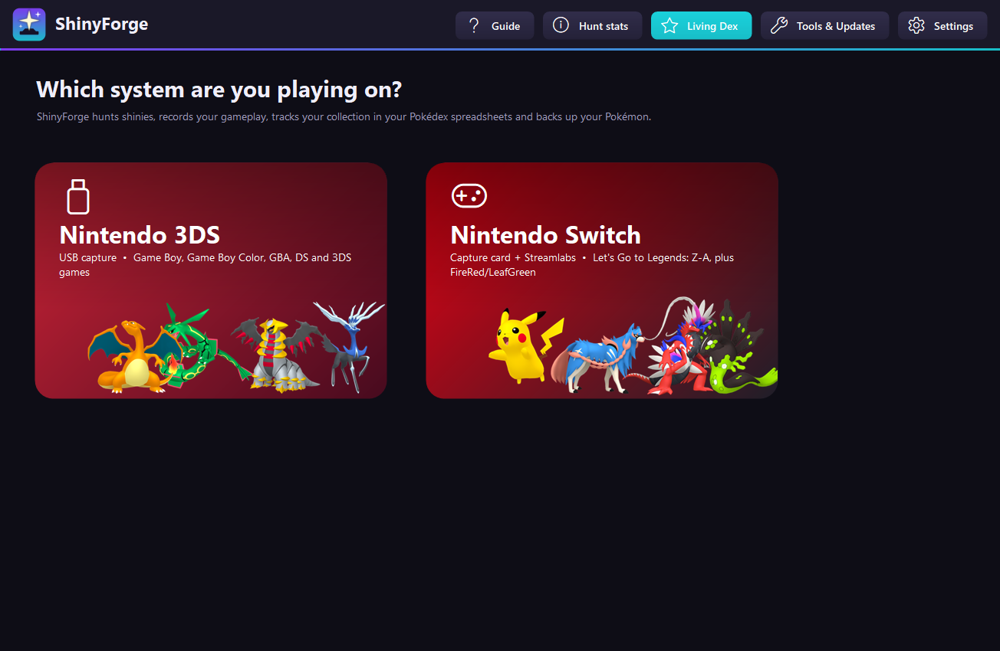
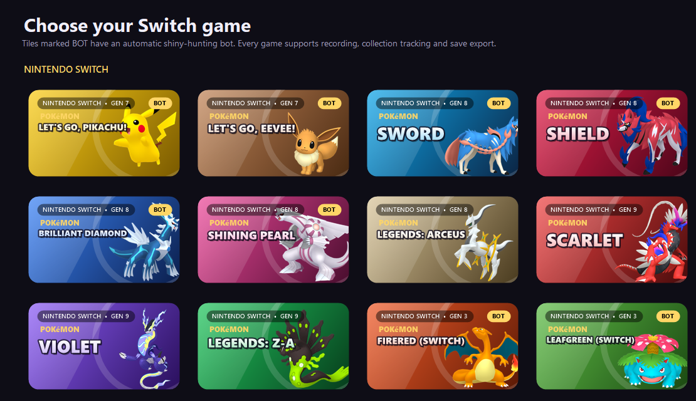
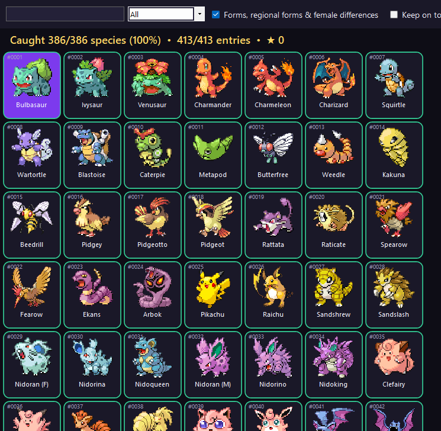
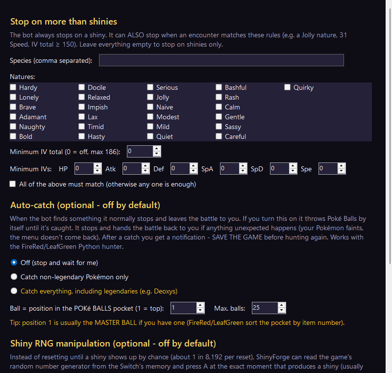

<p align="center">
  
</p>

<h1 align="center">ShinyForge</h1>

<p align="center">
  All-in-one Pokémon companion for Windows: automatic shiny hunting, gameplay recording,<br>
  Pokédex tracking and save management for the <b>Nintendo Switch</b> and <b>Nintendo 3DS</b>.
</p>

<p align="center">
  <a href="https://github.com/Domsanna/ShinyForge/releases/latest"></a>
  <a href="https://github.com/Domsanna/ShinyForge/releases"></a>
  <a href="LICENSE"></a>
  
  
</p>

<p align="center">
  
</p>

## Features

| | |
|---|---|
| ✨ **Automatic shiny hunting** | Soft resets, wild encounters and fishing on the Switch (FireRed/LeafGreen hunter, SysBot routines for Let's Go, Sword/Shield, BD/SP) and the 3DS (X/Y, ORAS, Sun/Moon, USUM over Luma3DS). Stops the moment a shiny appears. |
| 🎯 **Stop rules** | Also stop on chosen species, natures or IVs. |
| 🧪 **Optional extras** | Auto-catch and shiny RNG manipulation (FRLG). Both are **off by default** and only run when you turn them on. |
| 🎥 **Recording & shiny clips** | Gap-free recordings in numbered segments, plus an automatic clip and screenshot of every shiny. |
| 📋 **Pokédex tracker** | Updates your Excel Pokédex spreadsheet from your save. The Pokédex window uses each game's own sprites, forms and silhouettes. |
| 💾 **Saves & Game Info** | Reads saves from Red/Blue to Legends: Z-A and exports every Pokémon into a Pokémon HOME-ready folder. Also writes a readable Game Info report. |
| 🧬 **Living Dex planner** | Combines all your saves to show what you own, where, and what's missing. |
| 📈 **Hunt statistics** | Odds, the chance you'd have found a shiny by now, encounters per hour, ETA and a 24-hour chart. |
| 🔔 **Alerts, overlay & remote** | Discord / ntfy phone alerts, a stream overlay for OBS / Streamlabs, and a PIN-protected phone remote. |
| 🛡️ **Safety** | A system check every minute, a same-Pokémon guard, IP-change detection, keep-awake, automatic backups, and automatic updates from this page. |

<p align="center">
  
  
</p>
<p align="center">
  
</p>

## Download

Get the newest version from **[Releases](https://github.com/Domsanna/ShinyForge/releases/latest)**:

- **`ShinyForge-Setup.exe`**: the installer. It includes the Pokédex tracker spreadsheets and needs no admin rights.
- **`ShinyForge-Portable.zip`**: unzip and run. Everything stays in its folder, so it works from a USB drive.

ShinyForge checks this page for new versions when it starts. You can also check from **Tools & Updates**.

> Windows SmartScreen may warn that the program is unrecognised, because it isn't code-signed. Click **More info → Run anyway**.

## Requirements

- Windows 10 or 11 (64-bit). The .NET runtime is included.
- **Switch hunting:** a Switch running [Atmosphère](https://github.com/Atmosphere-NX/Atmosphere) with [sys-botbase](https://github.com/olliz0r/sys-botbase), on the same network as the PC.
- **3DS hunting:** a 3DS running [Luma3DS](https://github.com/LumaTeam/Luma3DS). Turn on InputRedirection and the debugger in the Rosalina menu.
- **Optional:** FFmpeg (recording), Python 3 (the FRLG hunter), Microsoft Excel (spreadsheets) and PKHeX. ShinyForge offers to install whatever is missing.

The full **User Guide** ships with the program: click **Guide** in the app, or see [`ShinyForge/ShinyForge User Guide.html`](ShinyForge/ShinyForge%20User%20Guide.html).

## Building from source

Requires the [.NET 10 SDK](https://dotnet.microsoft.com/download), [Inno Setup 6](https://jrsoftware.org/isinfo.php) for the installer, and Git.

```powershell
git clone https://github.com/Domsanna/ShinyForge.git
cd ShinyForge
.\build.ps1        # → dist\ShinyForge-Setup.exe, dist\ShinyForge-Portable.zip
```

Or double-click `Install tools and build.bat`, which installs the SDK and Inno Setup with winget and then builds.

**Version numbers:** the build number counts the changes ShinyForge has gone through (the number of commits), so every build is `1.0.<build>`. Releases are tagged `v1.0.<build>`, and the in-app updater compares against the latest tag.

| Folder | Contents |
|---|---|
| `ShinyForge/` | The WinForms app (`Core`, `Services`, `UI`, `Assets`) and the user guide |
| `PythonBot/` | The FireRed/LeafGreen Switch hunter (Python), bundled with the app |
| `installer/` | Inno Setup script |
| `tools/SelfTest/` | Test harness: `dotnet run -- <workdir> dex health features ...` |
| `tools/*.py` | Scripts that build the artwork and sprite assets from PokeAPI |

## Credits

ShinyForge is built on the work of many people. Thank you!

- **[PKHeX](https://github.com/kwsch/PKHeX)** (PKHeX.Core): Kurt (kwsch) and contributors. Save reading and Pokémon data.
- **[sys-botbase](https://github.com/olliz0r/sys-botbase)**: olliz0r. Switch control over WiFi.
- **[Atmosphère](https://github.com/Atmosphere-NX/Atmosphere)**: SciresM and contributors.
- **[SysBot.NET](https://github.com/kwsch/SysBot.NET)**: Kurt (kwsch) and contributors.
- **[Sys-EncounterBot.NET](https://github.com/Manu098vm/Sys-EncounterBot.NET)**: Manu098vm and contributors.
- **FRLG RAM research**: [Lusamine](https://github.com/Lusamine/SysBot.NET/tree/moarencounterbots), also used by LegoFigure11's GRASS.
- **[Luma3DS](https://github.com/LumaTeam/Luma3DS)** and Rosalina: AuroraWright, TuxSH and contributors.
- **3DSShinyHunter** (SirSnorealot), **PKMN-NTR** (drgoku282) and **Pokebot-3ds** (SHGliscor): 3DS protocols and memory offsets.
- **[NXBT](https://github.com/Brikwerk/nxbt)**: Brikwerk. Optional Raspberry Pi controller bridge.
- **[PokeAPI](https://github.com/PokeAPI/pokeapi)** and **[PokeAPI/sprites](https://github.com/PokeAPI/sprites)**: Pokédex data and sprites.
- **[FFmpeg](https://ffmpeg.org)**, with Windows builds by [Gyan Doshi](https://www.gyan.dev/ffmpeg/builds/).
- **[OpenCV](https://opencv.org)**, **[NumPy](https://numpy.org)**, **[python-mss](https://github.com/BoboTiG/python-mss)** and **[PyYAML](https://pyyaml.org)**.
- **[ntfy](https://ntfy.sh)**: Philipp C. Heckel. **[Inno Setup](https://jrsoftware.org)**: Jordan Russell and Martijn Laan.
- **Pokédex Tracker spreadsheets**: by Dom, the creator of ShinyForge.
- The Pokémon RNG research community, for Gen 3 Method 1.

The User Guide has the complete list with licenses.

## License

ShinyForge is free software under the **[GNU General Public License v3.0](LICENSE)**, the same license as PKHeX.Core, which it is built on.

## Disclaimer

Pokémon and all related names, characters and images are © Nintendo, Creatures Inc. and GAME FREAK inc. Nintendo Switch and Nintendo 3DS are trademarks of Nintendo. ShinyForge is a free, non-commercial fan project. It is not affiliated with, endorsed or sponsored by Nintendo, The Pokémon Company, Creatures Inc. or GAME FREAK inc.

Automatic hunting needs custom firmware. Use it only on consoles you own, back up your saves, and play offline when using homebrew. You use ShinyForge at your own risk.
